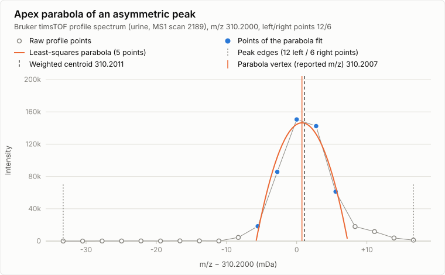
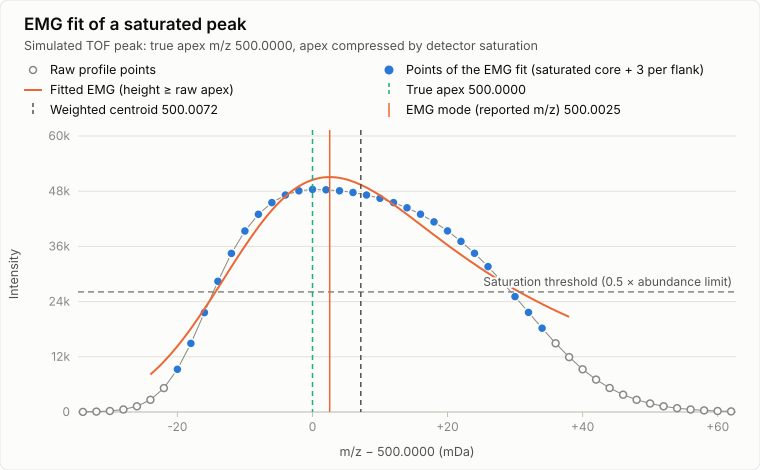

# Adaptive local maximum mass detector

:material-menu-open: **Raw data methods → Mass detection → Mass detection → Mass detector: Local
maximum (adaptive, beta)**

The adaptive local maximum mass detector centroids profile spectra. It finds and resolves peaks
exactly like the [Local maxima](mass-detection-algorithms.md#local-maxima) detector, but it picks
one of three m/z estimators per peak, depending on the peak:

| Peak                                                                       | m/z estimator                                                                                            |
|----------------------------------------------------------------------------|----------------------------------------------------------------------------------------------------------|
| Apex at or above the **saturation threshold** (if a threshold is set)      | Mode of an exponentially modified Gaussian (EMG) fitted to the saturated core and the unsaturated flanks |
| Intense (at least 1 % of the base peak of the spectrum) and **asymmetric** | Vertex of a least-squares parabola through the 5 points around the apex                                  |
| All other peaks                                                            | Intensity-weighted centroid, same as the local maximum detector                                          |

The weighted centroid of a tailing peak is pulled into its tail. The parabola follows the apex
instead. A saturated peak has a distorted (compressed) top, so neither the apex nor the weighted
centroid is reliable. The EMG fit uses the unsaturated flanks to reconstruct the apex position.

The detector is available in the **Mass detection** module and in the **Advanced import**
options of the data import. It only processes profile data.

!!! warning

    The detector is in beta. It was developed on time-of-flight (TOF) profile data, and the
    saturation handling was benchmarked on Agilent 6560 drift tube IMS data.

## Recommended citations

!!! info

    When using mzmine for your work, please consider citing: 
    Schmid R., Heuckeroth S., Korf A., et al. Integrative analysis of multimodal mass spectrometry data in MZmine 3, Nature Biotechnology (2023), doi:10.1038/s41587-023-01690-2.

---

## Parameters

#### Noise level

Absolute intensity threshold. A peak is only reported if its apex reaches
`max(noise level, 2 × lowest non-zero intensity of the spectrum)`, so peaks at the noise floor of
the spectrum are rejected even with a noise level of 0.

#### Minimum non-zero points

Minimum number of data points with an intensity above zero that a peak must contain. Removes
single-point spikes. Default: 3.

#### Intensity calculation

The reported intensity of each centroid:

- **Height** _(default)_: highest raw intensity of the peak.
- **Area**: sum of all raw intensities between the two peak edges (valley to valley).

The intensity does not depend on the m/z estimator. A saturated peak keeps its raw (too low) apex
height.

#### Smoothing

Optional smoothing before peak and edge detection, see
[Local maxima](mass-detection-algorithms.md#local-maxima) for the options. Default: **Gaussian**
with a width of 5 points.

The intensities and m/z values are always calculated from the raw, unsmoothed data.

!!! note

    Smoothing moves the peak edges, and the asymmetry decision counts the points up to the
    edges (see [Algorithm](#algorithm)). Turning smoothing on or off can therefore switch a peak
    between the parabola and the weighted centroid and change its m/z slightly, even though the
    m/z is calculated from the raw data in both cases.

#### Saturation threshold _(Optional)_

Raw intensity from which on a profile peak counts as saturated by the detector and gets the EMG
fit. Mobility scans, frames and spectra without mobility are handled separately, because a frame
sums all mobility scans of an accumulation and reaches much higher intensities.

| Option                            | Mobility scans                                                                                                                       | Frames                                                                       | Spectra without mobility                 |
|-----------------------------------|--------------------------------------------------------------------------------------------------------------------------------------|------------------------------------------------------------------------------|------------------------------------------|
| **Off** _(default)_               | no saturation handling                                                                                                               | no saturation handling                                                       | no saturation handling                   |
| **Manual**                        | the entered raw intensity                                                                                                            | the entered raw intensity                                                    | the entered raw intensity                |
| **Raw file metadata (else auto)** | 0.5 × the mobility scan abundance limit of the raw data file (Agilent IMS files) for the MS level, **Auto** if the file has no limit | same as **Auto**                                                             | **Auto** (no limit in the metadata)      |
| **Auto (saturation plateau)**     | 0.5 × the plateau of the mobility scan base peaks                                                                                    | 0.5 × the highest frame base peak, only if the mobility scans have a plateau | 0.5 × the plateau of the scan base peaks |

**Auto** looks at the base peak intensity of every mobility scan, or every spectrum without
mobility, of an MS level. The highest base peak is the saturation plateau if at least 10 spectra
have a base peak within 1 % of it. Otherwise the spectra count as unsaturated and the saturation
handling stays off for them.

Frames show no plateau of their own: a saturated ion reaches different frame intensities
depending on how many of its mobility scans are saturated. Frames therefore count as saturated if
the mobility scans of the same MS level have a saturation plateau. Their threshold is then half of
the highest frame base peak of the MS level. Without a mobility scan plateau, frames get no
saturation handling, also with **Raw file metadata**.

**Manual** applies the same value to all spectra that a mass detection step processes. To use
different values for frames and mobility scans, run the mass detection twice and select the
spectra with the **Scan types (IMS)** and **Scans** filters.

**Raw file metadata** and **Auto** need the imported raw data file. They are therefore not
offered in the **Advanced import** options, where only **Off** and **Manual** are available. With
**Manual** during import, the value applies to frames, mobility scans and other spectra of the MS
level alike.

!!! tip

    The factor 0.5 comes from a benchmark on Agilent 6560 data, where the isotope ratios of an ion
    start to distort from about 0.4–0.5 × the abundance limit. Use **Raw file metadata** for
    Agilent IMS data. For other instruments, use **Auto**, or a **Manual** threshold only if you
    know the intensity at which the detector saturates.

---

## Algorithm {#algorithm}

### Peak detection

Peak detection is identical to the [Local maxima](mass-detection-algorithms.md#local-maxima)
detector: the spectrum is split into consecutive m/z regions, local maxima are found on the
(optionally smoothed) intensities, and neighboring maxima are separated if the valley between them
drops below 70 % of the higher one and the next maximum rises above 1/0.7 of the valley. Each
resolved peak spans from its left edge to its right edge (region ends or valleys). The apex is the
highest raw data point between the edges.

### Choice of the m/z estimator

For each peak the detector tries the estimators in this order. If an estimator fails, the next one
is used.

1. **Saturated peak → EMG mode.** Used if a saturation threshold is set and the raw apex is at or
   above it. Independent of the peak intensity relative to the base peak.
2. **Weak peak → weighted centroid.** Peaks below 1 % of the base peak intensity of the spectrum
   always get the weighted centroid. Fits are unstable at low signal-to-noise, and the bias of the
   centroid is small there.
3. **Asymmetric peak → apex parabola.** The detector counts the data points between the apex and
   each edge (all points, including zero and low-intensity points). A peak is asymmetric if the
   larger count is at least 1.5 × the smaller count, or if the apex lies on an edge.
4. **Otherwise → weighted centroid.** Linear intensity-weighted mean m/z of the points above 40 %
   of the apex, within a window that is symmetric around the apex (as many points on each side as
   the shorter side has).

### Apex parabola

A parabola $y = a u^2 + b u + c$ with $u = m/z - m/z_\text{apex}$ is fitted by least squares to the
apex and two points on each side (5 points, fewer if an edge is closer). The reported m/z is the
vertex $m/z_\text{apex} - b / (2a)$. The parabola is rejected (fallback to the weighted centroid) if
fewer than 3 points are available, the top is too flat to define a vertex, or the vertex lies
outside the peak edges.

_Bruker timsTOF profile spectrum (urine, MS1). The peak has 12 points to its left edge and 6 to its
right edge, so it counts as asymmetric. The weighted centroid (dashed) is pulled into the tail to
higher m/z. The parabola (orange) through the 5 apex points (blue) places the m/z at 310.2007, 1.2
ppm below the weighted centroid. Most of the left points are low-intensity points down to the left
edge: the decision counts points to the edges, not the visible tail._

### EMG fit of saturated peaks

Detector saturation lowers and flattens the top of intense profile peaks, while the flanks keep
their shape. The detector fits an exponentially modified Gaussian, a Gaussian convolved with an
exponential tail to higher m/z,

$$f (x) \propto \exp\left (\frac{\sigma^2}{2\tau^2} - \frac{x-\mu}{\tau}\right)
\operatorname{erfc}\left (\frac{1}{\sqrt{2}}\left (\frac{\sigma}{\tau} - \frac{x-\mu}{\sigma}\right)\right),$$

to these points:

- the **saturated core**: all points between the edges from the first to the last point at or above
  the saturation threshold,
- **3 non-zero points on each flank** next to the core, within the peak edges.

All points have the same weight. The fitted apex height is not allowed to drop below the raw apex,
because saturation only lowers the apex. The reported m/z is the **mode** (apex position) of the
fitted EMG, not its Gaussian center $\mu$. The fit is rejected (fallback to steps 2–4) if fewer
than 3 points are available, a flank has no point below the threshold, the optimizer fails, or the
mode lies outside the fitted points.

_Simulated TOF peak with a true apex at m/z 500.0000 and a tail to higher m/z, whose top is
compressed by detector saturation. The 28 fitted points (blue) are the 22 points above the
saturation threshold plus 3 per flank. The EMG mode is 5.1 ppm from the true apex, the weighted
centroid of the compressed peak 14.3 ppm._

### Correction with neighboring mobility scans

Saturation only distorts the mobility scans at the apex of a drift peak. The unsaturated mobility
scans of the same ion keep the correct m/z. If a saturation threshold is set, the detector
processes all mobility scans of a frame together and corrects the saturated centroids:

1. Every centroid with an apex at or above the threshold starts a group.
2. The group follows the nearest centroid within 0.01 Da into the neighboring mobility scans in
   both directions. A single mobility scan without a match is bridged.
3. The m/z of the saturated members is replaced by the height-weighted mean m/z of the members
   below the threshold. Members below 2 % of the highest member are ignored, their m/z is dominated
   by counting noise.

If a group has no usable unsaturated member, the saturated centroids keep their EMG m/z.

### Agilent import

When Agilent .d files are imported with **Native (custom reader, all platforms)** and **vendor
centroiding** is enabled, profile data are centroided with this detector (Gaussian smoothing, 7
points) during import, independent of the mass detection parameters:

- **Mobility scans**: saturation threshold 0.5 × the mobility scan abundance limit of the file and
  MS level, including the correction with neighboring mobility scans.
- **Frames**: no saturation handling.
- **Spectra without mobility**: saturation threshold 0.5 × the abundance limit of the scan. With
  **Prefer stored centroids**, scans that already have stored centroids keep them, only
  profile-only scans are centroided. With **Prefer recentroided**, all profile scans are
  centroided.

Without an abundance limit in the file, the saturation handling is off.

The **Native (AgilentReader)** options use the Agilent reader. There, spectra without mobility
are centroided by the Agilent reader itself (stored or recentroided). With **Native (AgilentReader,
auto-centroid IMS)**, frames and mobility scans are centroided with this detector as described
above. The custom reader option also falls back to the Agilent reader in mzmine editions that do
not include the custom reader.

---

{{ git_page_authors }}
