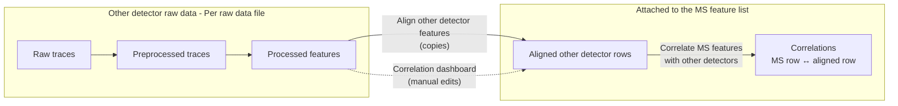
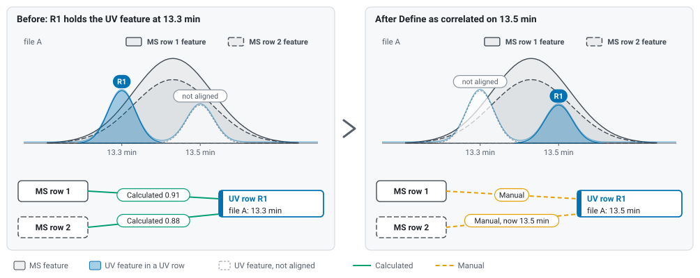
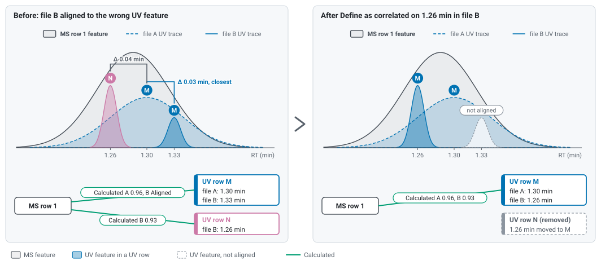
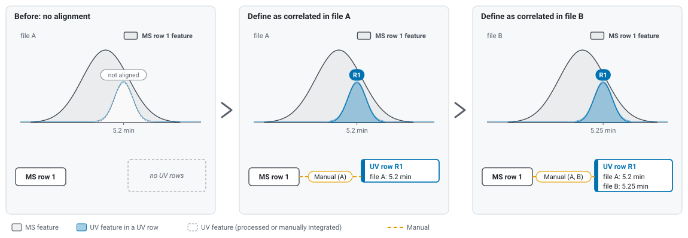

# Other detector data: before and after alignment

!!! info

    Processing data from other detectors requires the Other detector service of mzmine. This feature
    is included in the mzmine Pro subscription. Academic program and other users can inquire about
    [access options](https://mzio.io/#contact).

This page explains where mzmine stores data from other detectors (UV/DAD, CAD, radioactivity, …),
how the [alignment](uv_other_feature_aligner/uv_other_feature_aligner.md) and the
[correlation](uv_ms_other_aligner/uv_ms_other_aligner.md) to MS features build on each other, and
how
manual edits in the [Correlation dashboard](uv_correlation_dashboard/uv_correlation_dashboard.md)
change the stored results. For the terms trace, raw trace, preprocessed trace and feature, see the
[Other detector terminology](otherdetector_glossary.md).

!!! warning "Changed behavior"

    Earlier mzmine versions correlated each MS feature directly to the other detector features of
    its own raw data file and stored the **result on the MS feature**. Other detector features were **not**
    aligned across raw data files. mzmine now **aligns the other detector features first** and links
    MS feature list rows to **aligned other detector rows**. Manual edits in the correlation
    dashboard therefore change the aligned rows, which can **affect more than one MS row**. See
    [Manual edits in the correlation dashboard](#manual-edits).

## Overview

| Data                                | Stored with     | Created by                                                                                                                                                                                |
|-------------------------------------|-----------------|-------------------------------------------------------------------------------------------------------------------------------------------------------------------------------------------|
| Raw traces                          | Raw data file   | Data import, [Chromatogram builder (Other spectral data)](uv_spectra_chromatogram_builder/spectrachrombuilder.md)                                                                         |
| Preprocessed traces                 | Raw data file   | [Shift, trim, and bin traces](uv_shift_trim_bin_traces/uv_shift_trim_bin_traces.md), [Baseline correction](uv_baseline_correction/uv_baseline_correction.md)                              |
| Processed features                  | Raw data file   | [Local minimum resolver](uv_resolve_traces/uv_local_min_resolver.md), manual integration in the [Multi detector visualizer](uv_multi_detector_visualizer/uv_multi_detector_visualizer.md) |
| Aligned other detector rows         | MS feature list | [Align other detector features](uv_other_feature_aligner/uv_other_feature_aligner.md), [Correlation dashboard](uv_correlation_dashboard/uv_correlation_dashboard.md)                      |
| Correlations (MS row ↔ aligned row) | MS feature list | [Correlate MS features with other detectors](uv_ms_other_aligner/uv_ms_other_aligner.md), [Correlation dashboard](uv_correlation_dashboard/uv_correlation_dashboard.md)                   |

## Before alignment: data of each raw data file

Each raw data file holds its other detector data independently of any feature list:

- **Raw traces** as acquired by the detector.
- One **preprocessed trace** per raw trace, if a preprocessing module was applied. Each
  preprocessing module replaces the previous preprocessed trace. The
  [Baseline correction](uv_baseline_correction/uv_baseline_correction.md) adds its suffix to the
  trace
  name, e.g., `UV_VIS_1` becomes `UV_VIS_1 bl`.
- **Processed features**, the peaks resolved from the preprocessed trace (or the raw trace if there
  is none). Resolving a trace again **replaces** its processed features. Features that are manually
  integrated in the Multi detector visualizer also replace the processed features of that trace.

Processed features keep the name of the trace they were resolved from. This name is part of the
**trace identity** that the alignment uses (see below), so all raw data files should be processed
with the same preprocessing steps.

## Alignment: aligned other detector rows

[Align other detector features](uv_other_feature_aligner/uv_other_feature_aligner.md) groups the
processed features of all raw data files of an MS feature list into **aligned rows**, similar to the
rows of an MS feature list:

- **Trace identity:** features are only aligned if they have the same chromatogram type, wavelength,
  trace name and detector description. This identity is the "m/z equivalent" of an aligned row.
- **Retention time:** within one trace identity, features are aligned by retention time. Each row
  holds at most one feature per raw data file. Features that do not match any other file form
  single-file rows, so the aligned rows cover every detected peak.
- **Copies:** the aligned rows store copies of the processed features. Resolving or integrating a
  trace again does not change the aligned rows. Run the alignment again to pick up the changes.
- **Storage:** the aligned rows are attached to the MS feature list and saved with the project. They
  are carried over when the MS feature list is copied or filtered.

!!! warning

    Running the alignment again replaces all aligned rows **and all correlations** of the MS feature
    list, including manual edits from the correlation dashboard.

The aligned rows can be exported with **Export other detector feature table to CSV**, including the
IDs of the correlated MS feature list rows.

## Correlation: links between MS rows and aligned rows

[Correlate MS features with other detectors](uv_ms_other_aligner/uv_ms_other_aligner.md) requires
the aligned rows and stops with an error if the alignment was not run. For each raw data file, each
MS feature is compared to the aligned features of the same file within the RT tolerance. A
correlation is stored if the Pearson correlation of the peak shapes reaches the minimum score.

The correlations are stored as **links from an MS feature list row to aligned rows**. Each link
holds the correlation of every raw data file in which the two rows correlated:

- **Calculated:** correlated by the correlation module, with its Pearson score.
- **Manual:** set in the correlation dashboard, without a score.

The links of an MS row are sorted by their best score. The first link is the **preferred trace** of
the MS row. You can choose another preferred trace in the row-level **Correlated traces** column of
the feature table.

The feature-level **Correlated trace** column shows, for each raw data file, the peak of the
preferred trace in that file and its status:

- **Calculated** or **Manual** if the MS feature of this file correlated to the peak.
- **Aligned** if the preferred aligned row has a peak in this file, but the MS feature of this file
  did not correlate to it, e.g., in a blank or a low-concentration sample. This status is derived
  from the aligned rows and not stored.

Running the correlation again replaces all correlations, including manual ones.
[Clear correlated traces](uv_clear_correlated_traces/uv_clear_correlated_traces.md) removes all
correlations but keeps the aligned rows. Removing MS feature list rows, e.g., with a row filter,
also
removes their correlations.

## Manual edits in the correlation dashboard {#manual-edits}

The [Correlation dashboard](uv_correlation_dashboard/uv_correlation_dashboard.md) shows the
processed
features of the selected raw data file in its top plot, not only the aligned ones. This way,
manually integrated features and features that were not aligned can be correlated, too. The
dashboard changes the aligned rows and the correlations, never the processed features of the raw
data file.

!!! note

    Manual edits cannot be reproduced in batch mode. They are saved with the project. Running the
    alignment or the correlation again discards them.

### Define as correlated

**Define as correlated** correlates the selected other detector peak to the selected MS feature in
the selected raw data file. mzmine follows one rule: **each peak is held by at most one aligned row
per raw data file.** A peak is never duplicated, it is added or moved.

1. **Target row.** The peak goes to the first aligned row of the peak's trace that the MS row is
   linked to (in the order of the **Correlated traces** column). If the MS row is not linked to this
   trace, the row that already holds the peak is used. If the peak is not aligned yet, a new
   single-file row is created. If the MS feature list has no aligned rows yet, they are created.
2. **The target row already holds the peak.** The MS row gets a manual correlation in this file, if
   it is not correlated yet. Otherwise, nothing changes ("Already correlated").
3. **The target row holds another peak in this file.** The selected peak replaces it. The replaced
   peak is removed from the aligned rows (it stays a processed feature of the raw data file). All MS
   rows that were correlated to the target row in this file now refer to the new peak, so their
   correlation becomes **manual without a score**. This includes other MS rows, e.g., adducts or
   in-source fragments that share the aligned row.
4. **Another aligned row held the peak.** The peak moves to the target row together with all its
   correlations, which keep their status and score. The previous row is removed if it has no peaks
   left, or if it was correlated to MS rows before the move and is not anymore (only aligned peaks
   remain).
5. Finally, the MS row gets a manual correlation to the target row in this file, unless it already
   has one (e.g., a calculated correlation that moved with the peak).

!!! tip

    The replaced and moved peaks are listed in the applied method of the feature list, see
    [Logging](#logging).

#### Common cases

The steps above apply to every use of **Define as correlated**. In practice, these cases are the
most common:

- **The correct peak is shown as 'Aligned'.** The preferred aligned row holds the right peak in this
  raw data file, but the MS feature of this file did not correlate to it, e.g., because the score was
  below the minimum. **Define as correlated** only adds a manual correlation, the aligned rows do not
  change (step 2).
- **The aligned row holds the wrong peak.** Another peak of the same trace matches the MS feature
  better. The selected peak replaces the old one in the aligned row, and **all** MS rows correlated
  to this aligned row in this file now refer to the new peak (step 3). See
  [Example: pick a different peak of the same trace](#example-pick-a-different-peak-of-the-same-trace).
- **Several peaks correlated to the MS feature.** If the other detector trace contains multiple low
  intensity peaks inside the range of the MS peak, more than one of them may correlate to the MS
  feature. The MS row is then linked to several aligned rows of the same trace. **Define as
  correlated** moves the selected peak into the first of these rows. The row it came from is removed
  if no MS row is correlated to it anymore (step 4).
- **Peaks were aligned into the wrong rows.** The selected peak moves to the aligned row of the MS
  row together with its correlations (step 4). The peak that this row held in the raw data file
  before is removed from the aligned rows (step 3). See
  [Example: fix a misalignment](#example-fix-a-misalignment).
- **The peak is not aligned**, e.g., because it was integrated manually, or the alignment was not
  run. A single-file aligned row is created for it (step 1). See
  [Example: fully manual workflow](#example-fully-manual-workflow).

The following examples use UV data, but they apply to all other detectors. **MS row** is a row of
the MS feature list, **UV row** is an aligned other detector row. The figures show the MS features
in the background (MS row 2 dashed) and the UV features of one trace in front of them. The
misalignment example shows the UV traces of two raw data files in one plot.

#### Example: pick a different peak of the same trace

MS row 1 and MS row 2 (e.g., an adduct) are both correlated to **UV row R1**. In file A, R1 holds
the UV feature at 13.3 min, but the MS feature of MS row 1 matches the UV feature at 13.5 min,
which is not aligned.

| Before                                              | After **Define as correlated** on 13.5 min                    |
|-----------------------------------------------------|---------------------------------------------------------------|
| UV row R1, file A: 13.3 min                         | UV row R1, file A: 13.5 min                                   |
| MS row 1 → R1, file A: Calculated (0.91)            | MS row 1 → R1, file A: Manual                                 |
| MS row 2 → R1, file A: Calculated (0.88)            | MS row 2 → R1, file A: Manual (now refers to 13.5 min)        |
| 13.5 min: not aligned (processed feature only)      | 13.3 min: not aligned (processed feature only)                |

#### Example: fix a misalignment

In file A, the UV trace has a single broad UV feature at 1.30 min. In file B, the same RT range
contains two narrow UV features, a higher one at 1.26 min and a lower one at 1.33 min. The broad
feature of file A starts **UV row M**, and the lower feature of file B joins it because it is closer
in RT, 0.03 min instead of 0.04 min (see the
[alignment algorithm](uv_other_feature_aligner/uv_other_feature_aligner.md#algorithm)).
The higher feature at 1.26 min, which matches the MS feature of file B, starts its own **UV row N**.
MS row 1 is correlated to M in file A and to N in file B. M is its preferred UV row, so the
dashboard shows the 1.33 min feature of M as **Aligned** in file B.

| Before                                          | After **Define as correlated** on 1.26 min in file B          |
|-------------------------------------------------|---------------------------------------------------------------|
| UV row M, file B: 1.33 min                      | UV row M, file B: 1.26 min                                    |
| UV row N, file B: 1.26 min                      | UV row N: removed (no peaks left)                             |
| MS row 1 → M, file A: Calculated (0.96)         | MS row 1 → M, file A: Calculated (0.96)                       |
| MS row 1 → M, file B: Aligned (1.33 min)        | MS row 1 → M, file B: Calculated (0.93, moved with the peak)  |
| MS row 1 → N, file B: Calculated (0.93)         | 1.33 min: not aligned (processed feature only)                |

#### Example: fully manual workflow

Without running the alignment, select a processed or manually integrated UV feature in the
dashboard and use **Define as correlated**. mzmine creates the UV rows of the feature list, adds a
single-file UV row R1 for the feature and links it to MS row 1. Correlating UV features of the same
trace in other raw data files to MS row 1 fills R1 file by file.

### Clear selected correlation

**Clear selected correlation** removes the correlation of the MS row to the selected peak in the
selected raw data file. The peak stays in its aligned row, so it is shown as **Aligned** if its row
is
still the preferred trace. Once the MS row is not **correlated** to an aligned row in any raw data file,
the row is removed from the MS row's **Correlated traces** (e.g. all peaks are manually set to **aligned**)

### Logging {#logging}

All manual edits are added to the applied methods of the feature list as **Correlation dashboard -
Manual other detector edits**, one entry per dashboard session, with a
short description of each change. This entry cannot be applied in batch mode: when it is part of a
batch created from the applied methods, mzmine shows a warning.

---

{{ git_page_authors }}
