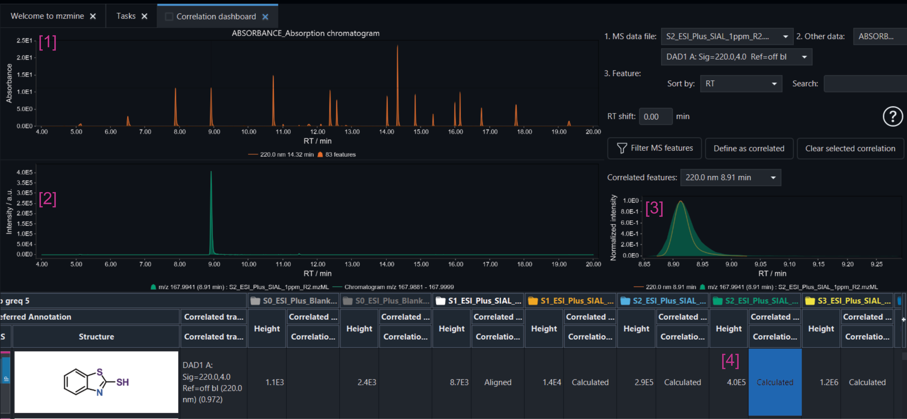
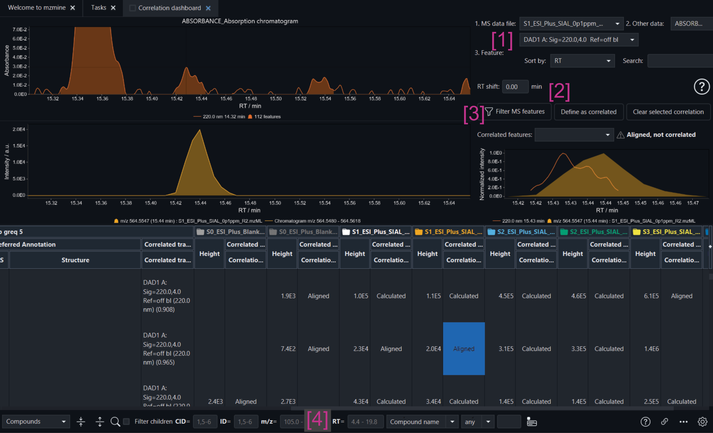

# Correlation dashboard

!!! info

    To process data from other detectors, the Other detector service of mzmine is required. This feature
    is included in the mzmine PRO subscription. Academic program and other users can reach out to
    inquire [access options](https://mzio.io/#contact).

The Correlation dashboard allows investigation of the results created by
[Correlate MS features with other detectors](../uv_ms_other_aligner/uv_ms_other_aligner.md) and
manual correction of the correlations. Manual edits change the aligned other detector rows of the
feature list, see
[Other detector data: before and after alignment](../otherdetector_data_handling.md#manual-edits)
for how each edit modifies the stored data.

## Interface

The interface is shown below:

1. Shows the full [preprocessed trace](../otherdetector_glossary.md#preprocessed-trace) (line) of the
   selected raw data file and all processed [features](../otherdetector_glossary.md#features) of this
   trace (filled areas), including features that are not aligned, e.g., manually integrated ones.
   The legend shows a single entry with the number of features. If an MS feature with a correlated
   trace is selected in the feature table, this plot shows that trace and positions the crosshair on
   the correlated feature. Selecting a different feature in this plot updates the overlay in
   plot **3** and is the feature used by **Define as correlated**.
2. Shows the full chromatogram (re-extracted from the raw data, line) and the selected feature from
   the feature table (area). Selecting a new feature in the feature table will update this plot. The
   RT axis is synchronized to plot **1**.
3. Shows an overlay of the selected MS feature (from the feature table) and the selected other
   detector feature, both normalized to their maximum. If a new MS feature is selected, this plot
   shows its correlated feature. Selecting a feature in plot **1** shows that feature instead. The
   plot stays empty if no other detector feature is selected, e.g., if the MS row has no correlated
   or aligned feature in the selected raw data file.
4. Shows the feature table with the **Correlated traces** (row level) and **Correlated trace**
   (feature level) columns, see
   [Correlate MS features with other detectors](../uv_ms_other_aligner/uv_ms_other_aligner.md#results).

### Selecting MS features and raw data files

- Clicking a cell in the columns of a raw data file selects this raw data file, even if the MS row
  has no feature in it.
- Clicking a cell in the row columns (e.g., ID, m/z, RT) keeps the selected raw data file. This way,
  changing the preferred trace in the **Correlated traces** column does not switch the raw data file.
- When no raw data file is selected yet, e.g., after opening the dashboard, mzmine selects the file
  of the most abundant feature of the row that has a correlation.
- If the MS row has no correlated or aligned feature in the selected raw data file, plot **1** shows
  the preferred trace of the row in this file, if the file has this trace (e.g., a blank), and plot
  **3** stays empty.

### Control panel

The additional controls are described below:

1. The trace selection allows selecting a specific other detector trace in case no correlation was
   found or the correlation was not executed yet.
2. Set an additional RT shift to the other detector trace. This is useful during method optimisation
   to determine the shift between the other detector and the MS. This shift can then be set in the
   wizard or the [Shift traces](../uv_shift_trim_bin_traces/uv_shift_trim_bin_traces.md) module.
   **Note**: this shift is applied onto already existing shifts, e.g. the default wizard shift. When
   reprocessing add this shift to the existing one.
3. **Filter MS features** sets the RT filter (**4**) of the feature table to the RT range of the
   currently selected other detector feature. This allows you to investigate all MS features that
   have their peak maximum in the RT range of the other detector feature. 
   **Define as correlated** correlates the feature selected in plot **1** to the selected MS feature
   in the selected raw data file. If the MS row already correlates to another feature of the same
   trace, that feature is replaced. A feature that is aligned in another row moves to the MS row's
   aligned row together with its correlations. Features that are not aligned yet are added to the
   aligned other detector rows, which are created if the alignment was not run. See
   [Define as correlated](../otherdetector_data_handling.md#define-as-correlated) for the exact
   rules. 
   **Clear selected correlation** removes the correlation of the selected MS feature to the selected
   other detector feature in the selected raw data file. The feature stays aligned. Note that there
   may be more than one correlated feature. This button only removes a single one.
4. The RT filter of the feature table, set by **Filter MS features**.

**Correlated features** lists the aligned other detector rows linked to the selected MS row that have
a feature in the selected raw data file. The preferred trace is selected. Selecting another entry
shows its trace in plot **1** and its feature in plot **3**, it does not change the preferred trace.
A warning next to the list explains why the displayed trace is not the expected one:

- **Different trace has correlation**: the MS feature is not correlated to the displayed trace in
  this raw data file, but to another trace. The tooltip lists the correlated traces.
- **Aligned, not correlated**: the preferred trace has an aligned feature in this raw data file, but
  the MS feature of this file is not correlated to it. Use **Define as correlated** to correlate it
  or select another trace from the list.

!!! warning

    Manual edits cannot be reproduced in batch mode. They are saved with the project and logged as
    the applied method **Correlation dashboard - Manual other detector edits**. Running
    [Align other detector features](../uv_other_feature_aligner/uv_other_feature_aligner.md) or
    [Correlate MS features with other detectors](../uv_ms_other_aligner/uv_ms_other_aligner.md)
    again discards them.

---

{{ git_page_authors }}
