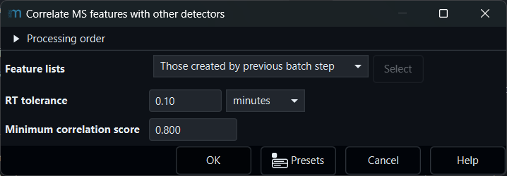

# Correlate MS features with other detectors

!!! info
    To process data from other detectors, the Other detector service of mzmine is required. This feature
    is included in the mzmine PRO subscription. Academic program and other users can reach out to
    inquire [access options](https://mzio.io/#contact).

This module correlates features of an MS workflow,
e.g., [LC-MS](../../../workflows/lcmsworkflow/lcms-workflow.md), to features from other detector
traces, allowing you to find which MS features are behind a certain peak in the UV, CAD, or
radioactivity chromatograms.

The MS features are correlated to the aligned other detector features of the feature list. Run
[Align other detector features](../uv_other_feature_aligner/uv_other_feature_aligner.md) first,
otherwise this module stops with an error. The correlations link MS feature list rows to aligned
other detector rows, see
[Other detector data: before and after alignment](../otherdetector_data_handling.md) for details.

!!! warning

    Running this module again replaces all correlations of the feature list, including manual
    correlations from the
    [Correlation dashboard](../uv_correlation_dashboard/uv_correlation_dashboard.md).

## Parameters

#### Feature lists

Select the feature list you want to correlate the other traces for. Each MS data file in the
selected feature list(s) will only be correlated to the aligned other detector features of its own
file. The selected feature list may be an aligned feature list.

The traces are selected in
[Align other detector features](../uv_other_feature_aligner/uv_other_feature_aligner.md): all
aligned features are candidates for the correlation.

#### RT tolerance

Allowed RT difference of the peak maxima in the MS and other detector features.

!!! warning
    This allowed RT tolerance does not cause an alignment of the other detector feature and the MS
    feature. If the traces are affected by an retention time shift, use
    the [Shift traces](../uv_shift_trim_bin_traces/uv_shift_trim_bin_traces.md) module to correct for that shift. Not
    correcting an existing retention time shift will cause poor correlation between the two detectors.

#### Minimum correlation score

Set a minimum (Pearson) correlation factor between the chromatographic shape of the two features.

## Results

The module adds two columns to the feature table. If they are not visible, enable them by clicking
the "+" in the upper right corner of the feature table.

- **Correlated traces** (row level): all aligned other detector rows correlated to the MS row,
  sorted by their best correlation score. The first entry is the **preferred trace**. Edit the cell
  to choose another preferred trace.
- **Correlated trace** (feature level): the peak of the preferred trace in this raw data file and
  its status: **Calculated** (with the Pearson score), **Manual** (set in the correlation
  dashboard), or **Aligned** (the preferred trace has a peak in this file, but this file's MS
  feature did not correlate to it).

Additionally, the [Correlation dashboard](../uv_correlation_dashboard/uv_correlation_dashboard.md)
allows a deeper investigation and also manually assigning or removing the correlated traces.

## Removing correlations

Use [Clear correlated traces](../uv_clear_correlated_traces/uv_clear_correlated_traces.md)
to remove every stored other-detector correlation from selected feature lists. This does not delete
raw traces, resolved other-detector features, aligned other detector rows, or MS features; it only
clears the links created by this module or assigned in the correlation dashboard.
