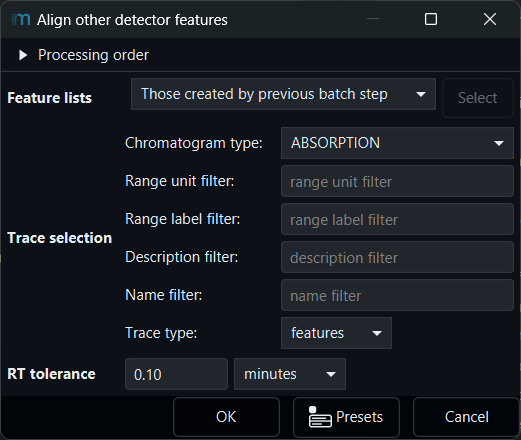

# Align other detector features

!!! info

    Processing data from other detectors requires the Other detector service of mzmine. This feature
    is included in the mzmine Pro subscription. Academic program and other users can inquire about
    [access options](https://mzio.io/#contact).

**Align other detector features** aligns the processed other detector features (UV/DAD, CAD, …) of
all raw data files of an MS feature list into aligned rows, similar to the rows of an MS feature
list. The aligned rows are attached to the MS feature list and are required by
[Correlate MS features with other detectors](../uv_ms_other_aligner/uv_ms_other_aligner.md). See
[Other detector data: before and after alignment](../otherdetector_data_handling.md) for how the
aligned rows relate to the data of the raw data files and to the correlations.

The LC-DDA-UV workflow of the [wizard](../../../wizard.md) runs this module automatically before the
correlation, with the inter-sample RT tolerance of the wizard.

!!! warning

    Run this module after all steps that create or change the rows of the MS feature list, e.g.,
    alignment, gap filling, intensity normalization, duplicate filtering, and blank subtraction.
    Running it again replaces the aligned rows **and all correlations** of the feature list,
    including manual edits from the
    [Correlation dashboard](../uv_correlation_dashboard/uv_correlation_dashboard.md).

## Parameters

#### Feature lists

The MS feature lists to align the other detector features for. The other detector features of all
raw data files of a feature list are aligned, usually an aligned MS feature list is selected.

#### Trace selection

Selects the other detector features to align. By default, the features of absorption (UV) traces are
aligned. For a description of the sub-parameters, see the
[trace selection parameter](../otherdetector_glossary.md#trace-selection-parameter).

#### RT tolerance

Maximum retention time difference for features of the same trace to be aligned across raw data
files. Default: 0.1 min. Correct systematic retention time shifts between the other detector and the
MS with [Shift, trim, and bin traces](../uv_shift_trim_bin_traces/uv_shift_trim_bin_traces.md)
before aligning.

## Algorithm {#algorithm}

1. **Trace identity.** Features are grouped by chromatogram type, wavelength, trace name and the
   description of the detector. Only features of the same group are aligned. All raw data files
   should therefore be processed with the same preprocessing steps, because some steps change the
   trace name, e.g., the baseline correction adds its suffix.
2. **Seed.** Within a group, the most intense feature of all raw data files (area, or height if
   there is no area) that is not aligned yet starts a new row.
3. **Closest feature per raw data file.** Each other raw data file adds the one feature that is not
   aligned yet and has the smallest RT difference to the seed, if it is within the RT tolerance.
   The difference is always measured to the seed, so the order of the raw data files does not
   matter. If two features are equally close, the more intense one is used.
4. **Repeat** with the next most intense feature that is not aligned yet, until all features are
   aligned. Features without a match therefore end up in **single-file rows**, so the aligned rows
   cover every processed feature.

The RT of a row is the average RT of its features.

!!! note

    Only the RT difference decides which feature of a raw data file joins a row, not its intensity.
    If a small noise peak is closer to the seed than the true peak, e.g., in a low concentration
    sample, the noise peak is aligned and the true peak starts its own row. Correct systematic RT
    shifts before aligning and check such rows in the
    [Correlation dashboard](../uv_correlation_dashboard/uv_correlation_dashboard.md), where
    [Define as correlated](../otherdetector_data_handling.md#define-as-correlated) moves a peak into
    the correct row.

The aligned rows store copies of the processed features. Resolving or manually integrating a trace
again does not change them until the alignment is run again.

## Results

The aligned rows are attached to the selected MS feature list and saved with the project. Use
**Export other detector feature table to CSV** to export them, including the IDs of the correlated
MS feature list rows.

---

{{ git_page_authors }}
